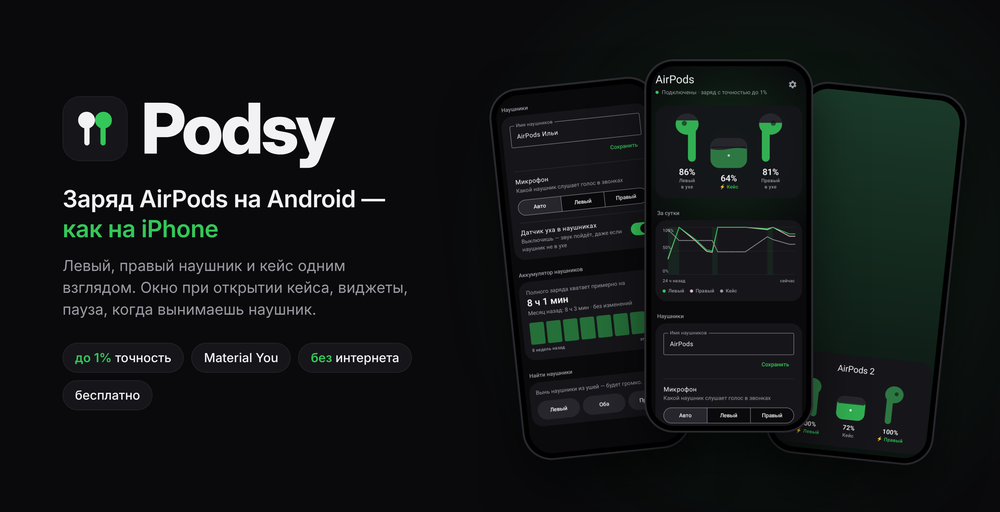
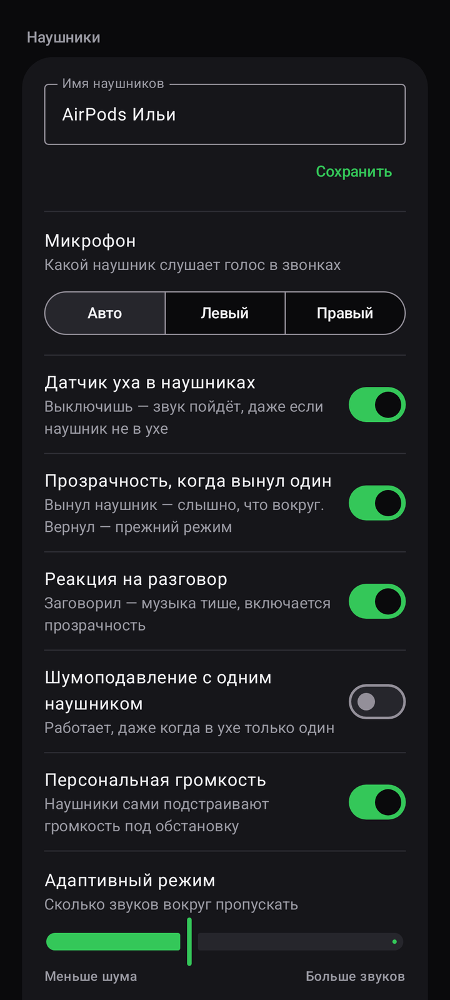
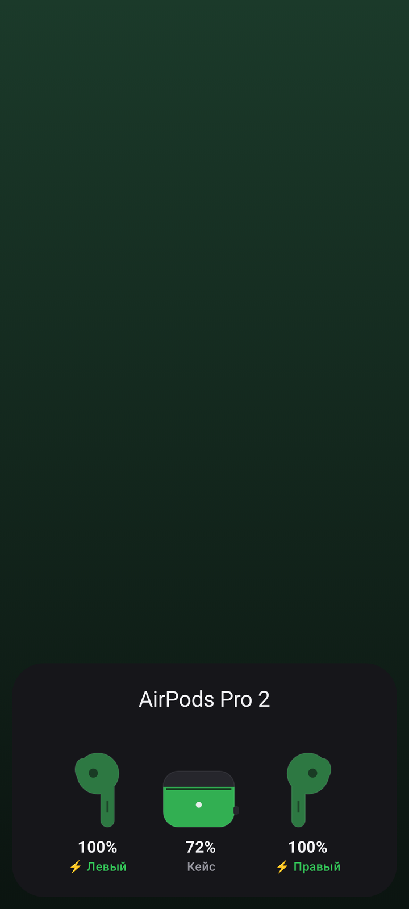

  

  

  Нажмите кнопку на телефоне — файл скачается сразу. 
  Открыли страницу на компьютере? Наведите камеру телефона на QR-код:

  

---

## Что это

**Podsy** — приложение для AirPods на Android. Показывает заряд левого и правого наушника и кейса так же, как iPhone, и даёт управлять режимами шума AirPods Pro без iPhone и без root.

Открыли кейс рядом с телефоном — снизу выезжает карточка с зарядом. Вынули наушник — музыка на паузе. Вынули один у AirPods Pro — включается прозрачность, слышно, что вокруг.

  
  &nbsp;
  
  &nbsp;
  

## Чем Podsy отличается

| | Podsy | Обычно в других приложениях |
|---|---|---|
| Точность заряда | **До 1%**, пока наушники подключены | Шаг 10% |
| Режимы шума AirPods Pro | **Есть**, без root | Нет или только с root |
| Настройки AirPods (имя, микрофон, сжатие ножки) | **Есть**, без root | Нет или только с root |
| Реклама и платные функции | **Нет**, всё бесплатно | Реклама или часть функций за деньги |
| Доступ в интернет | **Нет такого разрешения** | Обычно есть |

Точный заряд и настройки идут по закрытому протоколу Apple. На Honor Magic 8 Pro он работает без root. Если какой-то телефон его не пускает, Podsy показывает приблизительный заряд, как остальные приложения.

## Чего нет даже на iPhone

- 👂 **Автопрозрачность.** Вынул один наушник AirPods Pro — включается прозрачность, вернул — прежний режим.
- 📈 **История заряда за сутки** и оценка «хватит примерно на…».
- 🔋 **Износ аккумулятора наушников** по неделям.

## Что умеет

| | |
|---|---|
| 🔋 **Заряд** | Левый, правый, кейс. Последний заряд кейса не пропадает, видно, сколько минут назад он был |
| 🎧 **Режим шума** | Шумоподавление, прозрачность, адаптивный — на главном экране и плиткой в шторке |
| 🎚 **Адаптивный режим** | Ползунок: сколько звуков вокруг пропускать |
| 👆 **Ножка AirPods Pro** | Громкость свайпом, между какими режимами переключает долгое сжатие |
| 🗣 **Реакция на разговор** | Заговорил — музыка тише, включается прозрачность |
| 🪟 **Окно при открытии кейса** | Как на iPhone, с рисунком именно ваших наушников |
| ⏸ **Автопауза** | Вынул наушник — пауза, вернул — музыка продолжается |
| 📱 **Всегда на виду** | Виджеты 3×1 и 1×1, плитки в шторке, цифра в строке состояния, плашка Live Update на Android 16 |
| 🔔 **Напоминания** | При 20% и 10% заряда и когда наушники зарядились |
| 🔊 **Найти наушники** | Громкий писк в левый или правый наушник; место, где они отключились |
| ⚙️ **Настройки AirPods** | Имя, какой микрофон работает, датчик уха, шумоподавление с одним наушником |
| 🎨 **Material You** | Цвета из ваших обоев, тёмная тема, крупный шрифт и TalkBack |

  
  &nbsp;
  

## Как установить

1. **Скачайте файл.** Нажмите зелёную кнопку «Скачать APK» вверху страницы. Браузер может спросить «Скачать файл?» — нажмите **Скачать**.
2. **Откройте его.** Нажмите на уведомление о загрузке или найдите `podsy.apk` в папке «Загрузки».
3. **Разрешите установку.** Если телефон скажет «Установка из неизвестных источников запрещена» — нажмите **Настройки**, включите переключатель для браузера и вернитесь назад.
4. **Установите.** Нажмите **Установить**. Если появится предупреждение Google Play Защиты — нажмите **Подробнее → Всё равно установить**.
5. **Откройте Podsy.** Приложение попросит три разрешения и объяснит, зачем каждое.

> **Honor, Huawei, Xiaomi, Oppo, Vivo, Samsung** выгружают приложения в фоне. Чтобы заряд обновлялся всегда: Настройки → Батарея → Запуск приложений → Podsy → выключите «Автоуправление» и включите все пункты. Названия пунктов на разных телефонах немного отличаются.

Новая версия ставится поверх старой — настройки и история сохраняются.

## Частые вопросы

<b>Телефон пишет, что приложение может быть опасным. Это нормально?</b>

Да. Android так предупреждает о любом приложении не из Google Play. У Podsy нет доступа в интернет — оно не может ничего отправить или скачать.

<b>Почему заряд показывается с шагом 10%, а не до 1%?</b>

Точный заряд приходит, когда наушники подключены к телефону. Если они просто рядом, Android видит только приблизительный заряд, а на некоторых телефонах закрытый протокол Apple для точного заряда недоступен.

<b>Зачем приложению местоположение?</b>

Android выдаёт Bluetooth-пакеты наушников только приложениям с этим разрешением. Ещё оно нужно для карточки «Где оставил» — место хранится только на телефоне.

<b>Какие наушники поддерживаются?</b>

AirPods 2, 3, Pro, Pro 2 и Pro 3. Проверено на AirPods Pro 2 (USB‑C) и Honor Magic 8 Pro (Android 16). Режимы шума и настройки Pro появляются только у моделей, которые их поддерживают. Нужен Android 10 или новее.

<b>Как обновить?</b>

В приложении: Настройки → «Проверить обновления» откроет страницу последней версии. Скачайте её и установите поверх, удалять старую не нужно.

## Приватность

- **Нет доступа в интернет** — в приложении нет такого разрешения.
- Нет рекламы, аналитики и учётных записей.
- Всё, что приложение запоминает (история заряда, место отключения), хранится только на телефоне.

## Связь

Нашли ошибку или есть идея — [напишите в Issues](https://github.com/adamwoorhis-maker/podsy/issues): какой телефон, какие наушники и что случилось.

Все версии — в [Releases](https://github.com/adamwoorhis-maker/podsy/releases).

---

Podsy — независимое приложение и не связано с Apple Inc. AirPods — товарный знак Apple Inc., зарегистрированный в США и других странах.
