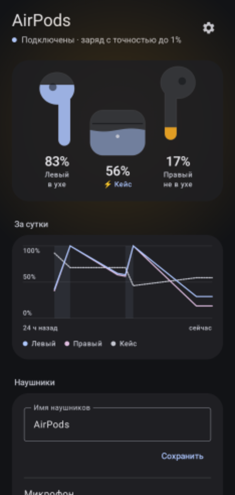
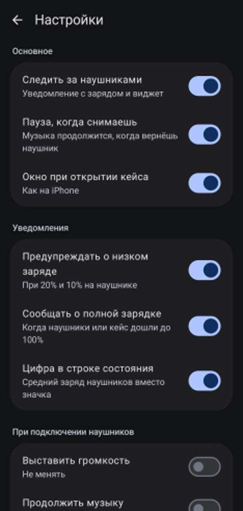
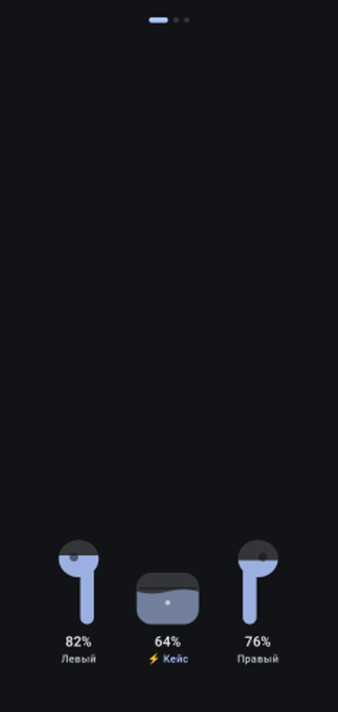

# Podsy

Заряд AirPods на Android — без лишнего. Левый, правый наушник и кейс одним взглядом, тёмная тема в цветах ваших обоев.

  
  
  

## Скачать

**[Последняя версия → Releases](https://github.com/adamwoorhis-maker/podsy/releases/latest)** — файл `podsy-X.Y.apk`.

## Что умеет

- **Заряд с точностью до 1%** у каждого наушника и кейса, пока наушники подключены. Когда не подключены — заряд при открытии кейса рядом с телефоном.
- **Окно при открытии кейса**, как на iPhone.
- **Пауза, когда вынимаешь наушник**, и продолжение, когда возвращаешь.
- **Виджеты** 3×1 и 1×1, плитка в шторке, цифра заряда в строке состояния.
- **Предупреждения** при 20% и 10%, уведомление «заряжено».
- **История за сутки** и оценка, на сколько хватит заряда; износ аккумулятора по неделям.
- **Найти наушники** — громкий писк в левый или правый; место, где наушники отключились.
- **Настройки самих наушников**: имя, какой микрофон работает, датчик уха.

## Установка

1. Скачайте `podsy-X.Y.apk` из [Releases](https://github.com/adamwoorhis-maker/podsy/releases/latest) на телефон.
2. Откройте файл. Если Android спросит — разрешите установку из этого источника.
3. При первом запуске Podsy попросит три разрешения и объяснит, зачем каждое.
4. На Honor, Huawei, Xiaomi и других прошивках, которые выгружают приложения в фоне: Настройки → Батарея → Запуск приложений → Podsy → выключить «Автоуправление» и включить все пункты.

Новая версия ставится поверх старой, настройки сохраняются.

## Требования

- Android 10 и новее.
- AirPods (2, 3, Pro, Pro 2, Pro 3). Проверено на AirPods 2 и Honor Magic 8 Pro (Android 16).
- Точный заряд до 1% работает через закрытый протокол Apple; на некоторых телефонах Android может его не пустить — тогда заряд будет с шагом 10%.

## Приватность

- У приложения **нет доступа в интернет** — оно физически не может ничего никуда отправить.
- Разрешения «Устройства поблизости» и «Местоположение» нужны Android, чтобы приложение видело Bluetooth-пакеты наушников. Место, где наушники отключились, хранится только на телефоне.
- Никакой рекламы, аналитики и учётных записей.

## Вопросы и ошибки

[Issues](https://github.com/adamwoorhis-maker/podsy/issues) — опишите телефон, модель наушников и что пошло не так.

---

Podsy — независимое приложение и не связано с Apple Inc. AirPods — товарный знак Apple Inc., зарегистрированный в США и других странах.
